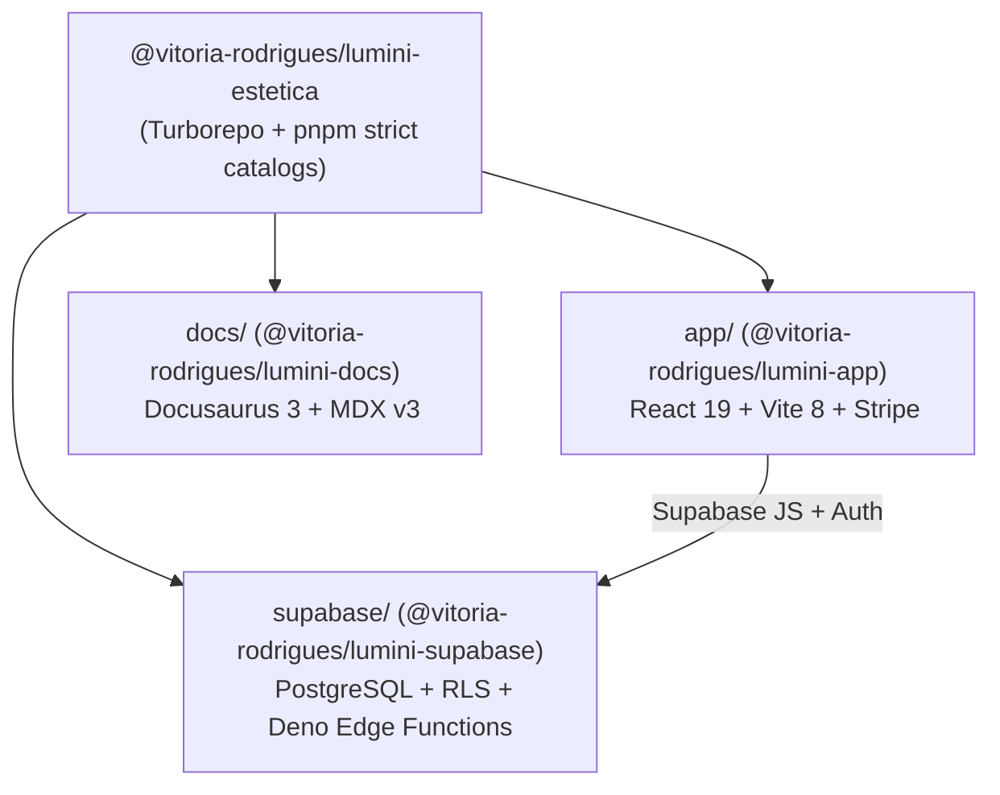

# Lumini Estética (`@vitoria-rodrigues/lumini-estetica`)

> [!NOTE]
> **Project Creator**: Vitória Rodrigues Ferreira
> **Tech Stack**: React 19, TypeScript 6, Zod, TanStack Query, Docusaurus 3, Supabase (PostgreSQL), Stripe, Turborepo, pnpm

This monorepo contains the complete management platform designed for aesthetic clinics. It centralizes client management, procedure catalogs, appointment scheduling, financial records, and technical documentation in a single Turborepo workspace.

---

## 1. Architecture Overview



### Workspace Structure

```text
Lumini-Estetica/
├── .agents/
│   └── plugins.json        # Antigravity plugin registry (@vitoria-rodrigues/agent-mesh)
├── .github/                # CI/CD workflows (deploy-app, deploy-docs, deploy-supabase)
├── app/                    # Frontend application (@vitoria-rodrigues/lumini-app)
├── docs/                   # Docusaurus portal (@vitoria-rodrigues/lumini-docs)
├── supabase/               # PostgreSQL migrations & Edge Functions (@vitoria-rodrigues/lumini-supabase)
├── AGENTS.md               # Sovereign root context router (Layer 1)
├── CODE_OF_CONDUCT.md
├── LICENSE.md
├── package.json            # Root monorepo manifest
├── pnpm-lock.yaml
├── pnpm-workspace.yaml     # Centralized pnpm strict catalogs
├── README.md               # Primary developer documentation
├── tsconfig.base.json
├── tsconfig.json
└── turbo.json
```

### Child Workspaces

| Workspace | Package Name | Purpose | Documentation |
| :--- | :--- | :--- | :--- |
| `app/` | `@vitoria-rodrigues/lumini-app` | Clinic management React + Vite frontend | [app/README.md](./app/README.md) |
| `docs/` | `@vitoria-rodrigues/lumini-docs` | Docusaurus technical documentation portal | [docs/README.md](./docs/README.md) |
| `supabase/` | `@vitoria-rodrigues/lumini-supabase` | PostgreSQL schemas, RLS, and Deno Edge Functions | [supabase/README.md](./supabase/README.md) |

---

## 2. Core Features, Roles & Requirements

### Managed Entities

- Client
- Employee
- Procedure
- Consultation

### Roles and Permissions

- **Admin**: Full access to all system functions.
- **Attendant**: Full access to Clients, read access to procedures, create and read access for consultations, update and read access for the calendar agenda.
- **Specialist**: Read access to procedures, read access to Clients, read access to the calendar agenda, and read and confirm access for consultations.

### Functional Requirements (FR)

- **FR01 - Client Registration**: CRUD operations for client records containing Name, CPF, Date of Birth, Observations, and Phone.
- **FR02 - Employee Registration**: CRUD operations for employees with Name, CPF, Phone, Role, and Specialty.
- **FR03 - Procedure Registration**: CRUD operations for procedures with Name, Description, Value, and Duration.
- **FR04 - Category Management**: Classification of procedures into `Facial` or `Corporal` categories.
- **FR05 - Appointment Scheduling**: Creating and viewing consultations linking a Client, Employee, and Procedure to a specific Date/Time.
- **FR06 - Observation Records**: Recording patient observations before or after a consultation.
- **FR07 - Agenda Status Control**: Updating consultation lifecycle status (`scheduled`, `performed`, `canceled`).
- **FR08 - Financial Records**: Storing transaction details (value, payment method, and status).
- **FR09 - Profile Control (RBAC)**: Restricting actions based on the authenticated role (`Admin`, `Attendant`, or `Specialist`).

### Non-Functional Requirements (NFR)

- **NFR01 - Data Protection**: Sensitive fields (such as CPF) must be protected and encrypted.
- **NFR02 - Authentication**: Access must require unique login credentials per user.
- **NFR03 - Centralized Interface**: Intuitive, unified interface consolidating clinic operations.
- **NFR04 - Referential Integrity**: Procedures or Clients with consultation history must use logical deletion/archiving rather than hard deletion.

---

## 3. Getting Started

### Prerequisites

- Node.js 20 or higher (CI targets Node.js 22)
- pnpm 10 (`packageManager: pnpm@10.33.2`)

### Installation

```bash
pnpm install
```

Configure environment variables in `app/` by copying [app/.env.example](./app/.env.example) to `app/.env` and filling in your Supabase and Stripe keys.

---

## 4. Pipeline Scripts

| Command | Description |
| :--- | :--- |
| `pnpm app:dev` | Starts the `@vitoria-rodrigues/lumini-app` Vite development server. |
| `pnpm app:build` | Builds `@vitoria-rodrigues/lumini-app` via Turborepo. |
| `pnpm app:typecheck` | Runs TypeScript checks for `@vitoria-rodrigues/lumini-app`. |
| `pnpm app:lint` | Runs ESLint for `@vitoria-rodrigues/lumini-app`. |
| `pnpm docs:dev` | Starts the Docusaurus dev server on port `3002`. |
| `pnpm docs:build` | Builds the `@vitoria-rodrigues/lumini-docs` static site. |
| `pnpm docs:typecheck` | Runs TypeScript checks for `@vitoria-rodrigues/lumini-docs`. |
| `pnpm docs:lint` | Runs ESLint for `@vitoria-rodrigues/lumini-docs`. |
| `pnpm build` | Builds all workspaces via Turborepo. |
| `pnpm lint` | Lints all workspaces via Turborepo. |
| `pnpm typecheck` | Typechecks all workspaces via Turborepo. |
| `pnpm format:check` | Verifies Prettier formatting across the repository. |

---

## 5. AI Agent Mesh Integration

This repository consumes organizational AI agent skills, rules, and MCP configurations via `@vitoria-rodrigues/agent-mesh` declared in `catalog:plugins-stack` ([pnpm-workspace.yaml](./pnpm-workspace.yaml)) and mounted through [.agents/plugins.json](./.agents/plugins.json).

---

## 6. Governance Standards

1. **Conventional Commits**: All commits must follow `<type>(<scope>): <description>` (v1.0.0).
2. **Cryptographic Signing**: Sign commits with SSH (`git commit -S -m "..."`) when a signing key is configured.
3. **Zero-Emoji Invariant**: Emojis are strictly prohibited in code, documentation, and commit messages.
4. **Secret Hygiene**: Never commit plaintext credentials; mirror all `.env` keys in `.env.example`.
